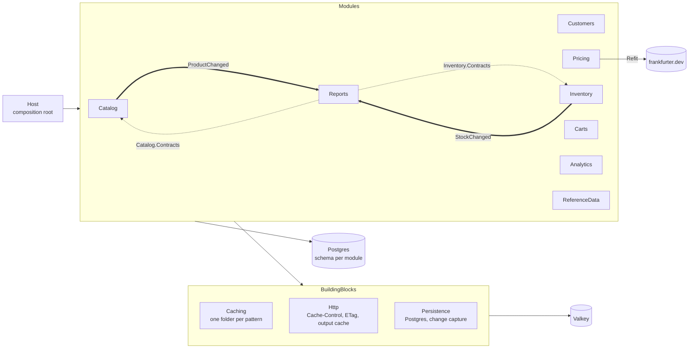

# CacheShowcase

A learning project: a .NET 10 **modular monolith** that implements the main backend **read, write, invalidation and
expiration** caching patterns, each in its own folder and each used by a business module where it fits.

- **Stack:** FastEndpoints, Refit, Dapper, PostgreSQL (source of truth), and Valkey (cache), accessed through StackExchange.Redis.
- **Licences:** every NuGet package is free and open source (MIT, Apache-2.0 or the PostgreSQL licence).
- **Scope:** no authentication, and no tests.

**Docs:** [`docs/pattern-map.md`](docs/pattern-map.md) lists every pattern: where it lives, who uses it, and how to see it
working. [`src/Host/CacheShowcase.Host/CacheShowcase.Host.http`](src/Host/CacheShowcase.Host/CacheShowcase.Host.http)
has a request for each.

## Quick start

```bash
docker-compose up -d                                  # Postgres (seeded), Valkey, Aspire dashboard
dotnet run --project src/Host/CacheShowcase.Host      # http://localhost:5080
curl -i http://localhost:5080/api/catalog/products/5  # watch X-Cache: MISS, then HIT
```

| What | Where |
|---|---|
| API | http://localhost:5080/api/… |
| Metrics, traces, logs | http://localhost:18888 (Aspire dashboard) |
| Valkey | `docker-compose exec valkey valkey-cli --scan --pattern 'cacheshowcase:*'` |
| Postgres | `docker-compose exec postgres psql -U cacheshowcase` |

With Podman, point Compose at the Podman socket first: `export DOCKER_HOST=unix:///run/user/$UID/podman/podman.sock`.
The seed scripts in `db/init` run only when the volume is empty, so use `docker-compose down -v` to reset.

To try the cross-instance patterns (pub/sub broadcast, leases), start a second instance:
`dotnet src/Host/CacheShowcase.Host/bin/Debug/net10.0/CacheShowcase.Host.dll --urls http://localhost:5081` (run it with `ASPNETCORE_ENVIRONMENT=Development` set).

## Architecture



### Modular monolith rules

1. **Modules are business areas, not pattern names.** Each module uses the patterns that suit its data, and the reusable
   mechanics live in `BuildingBlocks`.
2. **A module references other modules only through their `*.Contracts` project.** These hold integration events and
   read-only query interfaces. A module gets a Contracts project only when another module needs it, which is why only
   Catalog and Inventory have one. The compiler enforces this rule: `Reports` cannot see Catalog's internals.
3. **Each module owns its database schema and its cache namespaces.** Schemas are `catalog`, `inventory` and so on.
   Cache keys are prefixed by module (`catalog.product`, `inventory.stock`). No module reads or deletes another module's
   keys.
4. **Invalidation follows the same boundary.** Inside a module, a write invalidates its own entries directly. Across
   modules, it publishes an event, and each subscriber cleans up its own cache.
5. **`BuildingBlocks` never references a module.** `Host` is the only project that references every module.

### Design patterns

| Pattern | Where |
|---|---|
| Decorator | `CachedProductReader` / `CachedProductWriter` wrap the repository behind `IProductReader` / `IProductWriter`, so endpoints never see the cache |
| Strategy (by interface) | One interface per caching pattern (`ICacheAside`, `ISoftHardCache`, `ILeasedCache`, …), each chosen per use |
| Observer / pub-sub | FastEndpoints events between modules; Valkey pub/sub between instances |
| Template method | `PostgresChangeListener` (connect, `LISTEN`, reconnect); subclasses supply `Channel` and `HandleAsync` |
| Gateway | `ValkeyStore`: the single place that talks to Valkey and applies the fail-open policy |
| Options pattern | `CachingOptions` / `CacheNamespacePolicy` through `IOptionsMonitor`: runtime reload and the kill switch |
| Vertical slices | `Features/<UseCase>/` holds a use case's request, validator and endpoint |

## Folder structure

```
CacheShowcase/
├── db/init/                         One SQL script per module schema (+ seed data)
├── docs/pattern-map.md              Every pattern → mechanism → module → how to try it
├── docker-compose.yml               Postgres 18, Valkey 9.2, Aspire dashboard
└── src/
    ├── Host/CacheShowcase.Host/     Program.cs (wires modules), Observability/, appsettings, .http file
    ├── BuildingBlocks/
    │   ├── CacheShowcase.BuildingBlocks.Caching/
    │   │   ├── Keys/                CacheKey (namespace + schema version), CacheKeyspace (app/env prefix)
    │   │   ├── Stores/
    │   │   │   ├── Distributed/     ValkeyStore (fail-open gateway), CacheEntryCodec
    │   │   │   ├── InMemory/        LocalCache (size-limited L1)
    │   │   │   └── TwoLevel/        TwoLevelCache (L1 in front of L2)
    │   │   ├── Read/
    │   │   │   ├── CacheAside/      CacheAsideCache (+ batch MGET), CacheEntryContext
    │   │   │   ├── ReadThrough/     ReadThroughCache, ICacheLoader
    │   │   │   ├── RefreshAhead/    RefreshAheadCache
    │   │   │   ├── Warming/         ICacheWarmer, CacheWarmupService
    │   │   │   └── Memoization/     Memoizer
    │   │   ├── Write/
    │   │   │   ├── WriteAround/     WriteAround (source first, then invalidate)
    │   │   │   ├── WriteThrough/    WriteThroughCache
    │   │   │   ├── UpdateOnWrite/   VersionedCacheWriter (Lua compare-and-set), IVersioned
    │   │   │   └── WriteBehind/     WriteBehindCounter, WriteBehindFlusher, IWriteBehindSink
    │   │   ├── Invalidation/
    │   │   │   ├── KeyDelete/       CacheInvalidator
    │   │   │   ├── Generations/     CacheGenerations
    │   │   │   ├── DoubleDelete/    DoubleDelete
    │   │   │   ├── Leases/          LeasedCache (Lua store-if-lease-held)
    │   │   │   └── Broadcast/       L1InvalidationBroadcast (Valkey pub/sub)
    │   │   ├── Expiration/
    │   │   │   ├── Policies/        CacheNamespacePolicy (Ttl, NegativeTtl, SoftTtl, SlidingTtl, LocalTtl, …)
    │   │   │   ├── Jitter/          TtlJitter
    │   │   │   ├── Negative/        NegativeCaching
    │   │   │   ├── Sliding/         SlidingCache (GETEX)
    │   │   │   ├── SoftHard/        SoftHardCache
    │   │   │   ├── ProbabilisticEarly/  EarlyExpirationCache (XFetch)
    │   │   │   └── Upstream/        UpstreamFreshness
    │   │   ├── Serialization/       ICacheSerializer, JsonCacheSerializer
    │   │   ├── Diagnostics/         CacheMetrics, CacheLog, CachePatterns
    │   │   ├── Internal/            SingleFlight, BackgroundWork
    │   │   └── DependencyInjection/ AddCaching, AddCacheNamespace, AddReadThroughCache, AddWriteBehindCounter, …
    │   ├── CacheShowcase.BuildingBlocks.Http/
    │   │   ├── Headers/             CacheControl, ConditionalRequests (ETag, 304, If-Match), DefaultCacheControlMiddleware
    │   │   ├── CacheStatus/         RequestCacheStatus, CacheStatusHeaderMiddleware (X-Cache)
    │   │   └── OutputCaching/       OutputCacheTagEviction
    │   └── CacheShowcase.BuildingBlocks.Persistence/
    │       └── ChangeCapture/       PostgresChangeListener (LISTEN/NOTIFY)
    └── Modules/
        ├── Catalog/
        │   ├── CacheShowcase.Modules.Catalog.Contracts/   ProductChanged, ICatalogStatistics
        │   └── CacheShowcase.Modules.Catalog/
        │       ├── Domain/  Data/  Images/  Statistics/
        │       ├── Caching/         CatalogCacheKeys, CachedProductReader, CachedProductWriter
        │       ├── Features/        GetProduct, ListProducts, CreateProduct, UpdateProduct, GetProductImage
        │       └── CatalogModule.cs
        ├── Customers/               Caching/ CustomerLoader, CachedCustomerStore
        ├── Pricing/                 Client/ (Refit), ExchangeRates/, Currencies/, Tax/
        ├── Inventory/               (+ Contracts) Caching/ CachedStockStore, StockChangeListener
        ├── Carts/                   Caching/ CachedCartStore
        ├── Analytics/               Caching/ CachedProductViewStore, ProductViewSink
        ├── Reports/                 Features/CatalogOverview, Subscribers/
        └── ReferenceData/           Caching/ CachedCountryCatalog, CountriesWarmer
```

Every module has the same shape:
- `Domain/`, `Data/` (Dapper repository plus the interface the endpoints use) and `Caching/` (cache keys and the caching implementation).
- `Features/<UseCase>/` for the endpoints.
- `<Name>Module.cs`, which registers its services and declares its cache namespaces.

## Patterns by module

| Module | Patterns |
|---|---|
| **Catalog** | Cache-aside, negative caching, id-list caching + batched `MGET`, generation invalidation, write-around + key delete, delayed double delete, immutable content-addressed keys, ETag/304, `If-Match`/412, publishes `ProductChanged` |
| **Customers** | Read-through, write-through, update-on-write with versioned compare-and-set (Lua), `private` HTTP caching |
| **Pricing** | Refresh-ahead, upstream-derived TTL, negative caching, soft/hard TTL (stale-while-revalidate, stale-if-error), memoization, Refit client |
| **Inventory** | Leases (no stale sets, cross-instance stampede protection), change capture through a Postgres trigger + `LISTEN/NOTIFY`, publishes `StockChanged`, deliberately `no-store` over HTTP |
| **Carts** | Sliding expiration with an absolute cap (`GETEX`), write-around |
| **Analytics** | Write-behind counters with a background flusher, TTL-only invalidation, probabilistic early expiration (XFetch) |
| **Reports** | Output cache in Valkey, tag-based eviction, event-driven invalidation from two other modules |
| **ReferenceData** | Two-level (near) cache, cache warming, pub/sub broadcast invalidation of L1, TTL backstop |

Cross-cutting (all modules):
- single-flight stampede protection
- TTL jitter
- schema-versioned keys
- fail open when Valkey is down
- a runtime kill switch
- `no-store` by default, so errors are never cached
- the `X-Cache` header
- OpenTelemetry metrics tagged by namespace, pattern and outcome

## Endpoints

All routes are under `/api`.

| Method | Route | Patterns |
|---|---|---|
| GET | `/catalog/products/{id}` | Cache-aside, negative caching, ETag/304 |
| GET | `/catalog/products?category=&page=&pageSize=` | Id-list + generations + batch |
| POST | `/catalog/products` | Write-around + key delete, generation bump, `ProductChanged` |
| PUT | `/catalog/products/{id}` | Write-around + double delete, generation bump, `If-Match` → 412, `ProductChanged` |
| GET | `/catalog/images/{hash}` | Immutable key, `max-age=31536000, immutable` |
| GET / PUT | `/customers/{id}` | Read-through / write-through + compare-and-set |
| GET | `/pricing/exchange-rates/{base}` | Refresh-ahead, upstream TTL cap, negative caching; 502 when the provider fails and nothing is cached |
| GET | `/pricing/currencies` | Soft/hard TTL (`X-Cache: STALE`) |
| GET | `/pricing/tax?country=&category=&amount=` | Memoization |
| GET | `/inventory/{productId}` | Leases |
| POST | `/inventory/{productId}/adjustments` | Revoke entry + lease; change capture also invalidates |
| GET | `/carts/{cartId}` | Sliding expiration |
| POST | `/carts/{cartId}/items` | Write-around |
| POST | `/analytics/products/{productId}/views` | Write-behind (`202 Accepted`) |
| GET | `/analytics/trending?limit=` | TTL-only + XFetch |
| GET | `/reports/catalog-overview` | Output cache, tag eviction on `ProductChanged` / `StockChanged` |
| GET | `/reference-data/countries` | Two-level cache, warmed at startup |
| PUT | `/reference-data/countries/{code}` | L2 delete + L1 broadcast |

**`X-Cache` header values:**
- `HIT`: everything came from the cache.
- `MISS`: nothing came from the cache.
- `PARTIAL`: some values came from the cache and some from the source.
- `STALE`: a value was served past its soft TTL.
- `BYPASS`: the cache was skipped, because it is switched off or unavailable.

Output-cache replays don't run the handler, so they carry an `Age` header instead of `X-Cache`.

## Cache keys and policies

Keys look like `{KeyPrefix}:{environment}:{module.name}:v{schema}:{parts}`, for example
`cacheshowcase:development:catalog.product:v1:42`. Modules declare their namespace policies in code with
`AddCacheNamespace`. Any value can be overridden under `Caching:Namespaces:{namespace}` in configuration, and changes apply
without a restart. **TTLs are deliberately short so each pattern can be watched within minutes.**

| Namespace | Pattern | Ttl | Other |
|---|---|---|---|
| `catalog.product` | Cache-aside | 5 min | NegativeTtl 30 s |
| `catalog.product-ids` | Cache-aside + generations | 1 min | NegativeTtl 10 s |
| `catalog.image` | Immutable | 1 day | NegativeTtl 1 min |
| `customers.customer` | Read-through / write-through | 10 min | NegativeTtl 30 s |
| `pricing.exchange-rates` | Refresh-ahead | 2 min (capped by upstream) | RefreshAheadRatio 0.5, NegativeTtl 5 min |
| `pricing.currencies` | Soft/hard | 1 h (hard) | SoftTtl 30 s |
| `inventory.stock` | Leases | 30 s | NegativeTtl 10 s, lease 5 s |
| `carts.cart` | Sliding | 30 min (cap) | SlidingTtl 2 min |
| `analytics.trending` | XFetch | 20 s | EarlyExpirationBeta 1.0 |
| `reference-data.countries` | Two-level | 1 h (L2) | LocalTtl 1 min (L1) |

Global settings:
- `JitterRatio` 0.1 (shorten-only)
- `GenerationTtl` 7 days
- `DoubleDeleteDelay` 500 ms
- `LocalCacheSizeLimit` 1000
- write-behind flush every 10 s
- the Reports output cache keeps responses for 1 minute

## Observability

The Host exports OpenTelemetry to the Aspire dashboard.

**Cache metrics** (meter `CacheShowcase.Caching`):

| Metric | Tags |
|---|---|
| `cache.lookups` | `cache.namespace`, `cache.pattern`, `cache.outcome` |
| `cache.invalidations` | `cache.namespace`, `cache.pattern` |
| `cache.errors` | `cache.operation` |
| `cache.load.duration` | `cache.namespace` |
| `cache.write_behind.flushed` | `cache.buffer` |

**Traces** cover ASP.NET Core, `HttpClient` (Refit) and Npgsql.

**Logs:** set `CacheShowcase` to `Debug` in `appsettings.Development.json` to log every miss, invalidation, refresh and
recompute.

## Verified behaviour

Each pattern was exercised against the running stack, using the steps in `docs/pattern-map.md`:
- **Reads:** misses turn into hits, a repeat request with the ETag gets 304, 404s are negatively cached, and list pages show `PARTIAL`.
- **Writes and invalidation:**
  - The generation counter advances (with a 7-day TTL).
  - A stale `If-Match` gets 412.
  - Double delete fires twice.
  - Write-through gives read-your-writes, and its compare-and-set refused an older version.
  - Refresh-ahead moved `storedAt` without a miss.
  - `STALE` was served while the provider was unreachable.
- **Cross-module and cross-instance:**
  - A manual SQL `UPDATE` reached the cache through change capture and also evicted the report.
  - An L1 eviction reached a second instance.
  - XFetch recomputed 0.38 s before expiry.
- **Stampede:** 50 concurrent misses produced **1** SQL query with single-flight, and **1** with leases.
- **Valkey stopped:**
  - Every endpoint answered in milliseconds with `BYPASS`.
  - The L1 country list kept hitting.
  - Write-behind wrote straight to Postgres.
- **Kill switch:** flipping it at runtime gave `BYPASS` and back, with no restart.

There are no automated tests (out of scope).

## Assumptions

1. **.NET 10**, the installed SDK.
2. **Postgres + Dapper as the source of truth.** You asked for FastEndpoints, Refit and Valkey; a database is needed for
   anything to be cached. Postgres is also what makes change capture (`LISTEN/NOTIFY`) possible.
3. **StackExchange.Redis as the Valkey client.** Valkey speaks the Redis protocol, and this client is the mature MIT
   option. Lua scripts use `cjson`, which Valkey ships.
4. **No authentication.** Every endpoint is public, so nothing is cached per user. Customer responses still use
   `Cache-Control: private` to show the directive.
5. **FastEndpoints' in-process event bus** carries integration events, with no outbox or message broker. Events are
   published after the database commit with `Mode.WaitForAll`.
6. **Contracts projects only where needed** (Catalog, Inventory), not for every module.
7. **The `Tags` folder from the proposed structure moved to `BuildingBlocks.Http/OutputCaching`.** Tag invalidation uses
   ASP.NET Core's output cache, whose tag index lives in Valkey.
8. **`ChangeCapture` moved to `BuildingBlocks.Persistence`**, so the caching block does not depend on Npgsql.
   `LISTEN/NOTIFY` stands in for log-based CDC such as Debezium.
9. **Some patterns are placed for teaching value, not as the best choice for that data.**
   - Leases on stock and sliding expiration on carts are reasonable choices.
   - XFetch on a trending list uses an artificial `pg_sleep(0.25)` so that early recomputes are visible.
   - Memoizing a cheap tax lookup stands in for an expensive pure function.
10. **Seed data comes from SQL init scripts** (`db/init`), with no migration tool. In a real system each module would own its
    migrations.
11. **A single Valkey node.** Leases need the entry and its lease on one node; a cluster would need hash tags.
12. **Pricing calls frankfurter.dev**, so those endpoints need internet access.
13. **Local credentials and an unauthenticated dashboard** are for local use only.

## Known limitations

- **Write-behind is at-least-once.** A crash between "written to Postgres" and "buffer deleted" re-delivers the batch.
  Increments still in Valkey are lost if Valkey restarts, because Compose runs it without persistence.
- **Pub/sub and `LISTEN/NOTIFY` are fire-and-forget.** Messages sent while an instance is disconnected are lost, and TTLs are the backstop.
- **Single-flight, the L1 cache and background refreshes are per process.** Refresh-ahead can therefore refresh once per instance.
- **Double delete is probabilistic.** A reader slower than the 500 ms delay can still store a stale value until the TTL.
  Leases (used in Inventory) close that gap completely.
- **The kill switch covers the application caches, not the HTTP output cache or the in-process memoizer.**
